# CAMAI бдительность (CAMAI vigilance)

Контроль присутствия и взгляда перед экраном — фоновая утилита для **Radxa ROCK 5T** (RK3588)
и любого Linux-ПК с камерой, установленной по центру верхней кромки дисплея. Работает поверх
любого ПО, управляется из системного трея. Интерфейс — **русский и английский** (по умолчанию —
язык системы, переключается в настройках).

| № | Функция | Вкл/выкл |
|---|---------|----------|
| 1 | Детекция человека перед экраном (события «появился / ушёл») | всегда |
| 2 | Распознавание по локальной базе авторизованных лиц | всегда, если база не пуста |
| 3 | Блокировка экрана, если перед камерой никого нет дольше таймаута | ✔ + таймаут |
| 4 | Блокировка, если нет авторизованного лица (даже при наличии других) | ✔ + таймаут |
| 5 | Блокировка при появлении постороннего лица (даже рядом с авторизованным) | ✔ + время подтверждения |
| 6 | Контроль взгляда: красная рамка → мигающая рамка → звуковой сигнал → уведомление на e-mail; при возврате взгляда всё сбрасывается | ✔ + время каждой стадии, звук (3 встроенных + свои) |

* Уведомление на e-mail по контролю взгляда отправляется один раз за эпизод, если взгляд не на экране
  дольше заданного времени; поле доступно, когда для событий контроля взгляда включено «E-mail сразу».
* Вкладка **«Диагностика»** — ресурсы одноплатника, которые использует программа, в реальном
  времени: CPU (программа, система, каждое ядро, история за 2 минуты), NPU (занятость, время
  моделей), память, температура датчиков, время обработки кадра, диск, очередь писем. Шкалы
  окрашиваются зелёным, жёлтым или красным в зависимости от нагрузки.
* Значок программы — логотип CAMAI (`assets/`); в трее — монохромный вариант. На тёмной теме
  оформления «C» белая, на светлой — чёрная (и в меню приложений, и в трее, и в заголовках окон);
  тема определяется автоматически (KDE: стиль Plasma и цветовая схема; GNOME: color-scheme) и
  отслеживается во время работы. Можно задать вручную: «Общие → Цвет значков». Центральная точка показывает состояние: сплошная —
  авторизованный пользователь у экрана, кольцо — никого нет, мигает — посторонний или взгляд не на
  экране, «пауза» — контроль приостановлен, крестик — ошибка (например, камера недоступна).
* Настройки — из трея, **только после ввода логина и пароля** (PBKDF2-SHA256, защита от
  перебора). Пароль также нужен для приостановки контроля и выхода из программы.
* События по каждому пункту (1–6 и служебные) независимо направляются:
  **на e-mail сразу**, **в журнал**, **в журнал + e-mail по расписанию** (каждые N минут или
  ежедневно в заданное время; отчёт содержит сводку и CSV-вложение). К письмам и записям журнала
  можно прикладывать снимок с камеры.

## Стек и нагрузка на систему

Стек выбран так, чтобы утилита занимала минимум ресурсов и оставляла производительность прикладному ПО:

| Компонент | Технология | Почему |
|-----------|-----------|--------|
| Детекция лиц | OpenCV **YuNet** (230 КБ): весь кадр 320 px раз в секунду, между ними — только окрестности найденных лиц 128×128 | полный просмотр ~5 мс, окрестность ~2 мс на 1 ядре x86 |
| Распознавание | OpenCV **SFace** (128-мерный вектор) | запускается только для новых лиц и раз в 2 с для известных (трекер с голосованием) |
| Взгляд | модель 478 точек лица из MediaPipe, выполняемая **напрямую** через **LiteRT** (или OpenCV DNN) в 1 поток, на выровненной вырезке лица 256×256; поворот головы — совмещением с эталонной 3D-моделью | без библиотеки MediaPipe, её детектора и фоновых потоков; загружается лениво, работает только при включённом п.6, только для авторизованного лица и 2,5 раза/с, пока нет предупреждения. Можно отключить точную оценку — тогда по 5 точкам YuNet (почти бесплатно) |
| GUI | системный **PyQt5** (или PySide6) | библиотеки Qt5 уже загружены рабочим столом KDE (Radxa OS); окно настроек создаётся только при открытии |
| Рамка | 4 узких окна-полосы на монитор | не нужен композитор/прозрачность, нет полноэкранной перерисовки |
| Звук | `paplay` / `pw-play` / `ffplay` / `aplay` | без аудиобиблиотек в процессе |

Экономия ресурсов:

* **Адаптивная частота анализа**: 2 кадра/с, когда никого нет; 5 кадров/с, когда человек в кадре.
* **Поиск лица в окрестности**: весь кадр просматривается раз в секунду (и сразу, если лицо
  потерялось), в остальное время — только области вокруг найденных лиц (в 3 раза дешевле).
* **Взгляд оценивается 2,5 раза/с**, пока нет предупреждения, и на каждом кадре при активной рамке —
  чтобы рамка и звук исчезали сразу при возврате взгляда.
* Камера в фоне только забирает кадры из драйвера (`grab`), а **декодирует лишь нужные** (`retrieve`).
* OpenCV и BLAS — **1 поток**; процесс работает с пониженным приоритетом (**nice 10**).
* **Привязка к энергоэффективным ядрам**: по умолчанию только Cortex-A55 (cpu0-3 на RK3588),
  производительные **A76 (cpu4-7) остаются другим программам**. Настраивается («Общие → Нагрузка»).

Замер на одном ядре x86 (`scripts/benchmark.py`, кадр 640×480), версия 1.0 → 1.1:

| Режим | CPU 1.0 (MediaPipe) | CPU 1.1 | Память 1.0 → 1.1 |
|-------|-----|-----|--------|
| Никого нет (2 кадра/с) | 1.3 % | 1.2 % | 185 → 185 МБ |
| Человек в кадре (5 кадров/с) | 4.0 % | 2.5–2.8 % | 185 → 185 МБ |
| + контроль взгляда | 10.6 % | **4.3–4.4 %** (LiteRT), 5.5 % (OpenCV) | 260 → **188 МБ** |

Переписывание на C++ почти ничего бы не дало: логика на Python — около 2 % нагрузки,
остальное — нейросети, которые и так выполняются в C++-библиотеках.

### NPU RK3588 (версия 1.2)

На ROCK 5T все четыре нейросети — поиск лица (весь кадр и окрестность), распознавание и точки
лица — выполняются на **нейропроцессоре RK3588**, а не на ядрах CPU. Процессору остаются только
подготовка кадров и логика. Если NPU недоступен (нет драйвера, библиотеки или моделей), программа
автоматически работает на CPU; выбор — «Общие → Нейросети выполнять на».

* Модели `.rknn` (FP16, без квантования) лежат в `models/rknn/`; сконвертированы
  `scripts/convert_rknn.py` и проверены в симуляторе Rockchip: расхождение с CPU — сотые доли
  процента (см. `models/rknn/manifest.json`).
* Библиотека выполнения `librknnrt.so` 2.5.0 вызывается напрямую через её C-интерфейс (`ctypes`),
  поэтому подходит любая версия Python (Python-пакета Rockchip для 3.13+ нет).
  Устанавливается `install.sh` с проверкой SHA-256.
* NPU-задачи запускаются с низким приоритетом, чтобы не мешать другим программам, использующим NPU.
* Проверка на плате: `~/.local/share/eyetracker/venv/bin/python ~/eyetracker/scripts/npu_check.py` —
  сравнивает каждую модель на NPU с CPU, замеряет время и общую нагрузку в обоих режимах.

На Cortex-A55 ожидается примерно в 4–6 раз больше доли одного малого ядра; ядра A76 не задействуются.

## Установка (Radxa OS / Debian 12 / Ubuntu)

> **Пошаговая инструкция** с проверкой камеры, настройкой почты, обновлением, удалением и решением
> проблем — в [docs/INSTALL.md](docs/INSTALL.md).

```bash
git clone <репозиторий> eyetracker && cd eyetracker
./install.sh                    # или WITH_LITERT=0 ./install.sh
```

Скрипт ставит системные пакеты (`python3-pyqt5`, проигрыватель звука, `v4l-utils`), создаёт venv
в `~/.local/share/eyetracker/venv`, ставит OpenCV (headless) и LiteRT, скачивает модели
(YuNet, SFace, FaceLandmarker — с проверкой SHA-256) и добавляет пользователя в группу `video`.

Обновление: `git pull && ./install.sh`; удаление: `./uninstall.sh` (с `--purge` — вместе с данными).

Запуск: `~/.local/bin/eyetracker`. При первом запуске программа попросит **задать логин и пароль
администратора** и откроет настройки. Автозапуск при входе в систему включён по умолчанию
(`~/.config/autostart/eyetracker.desktop`).

Проверка окружения: `~/.local/bin/eyetracker --check` (камеры, модели, команды блокировки, звук, ядра CPU).

## Первичная настройка

1. **Камера** — выберите источник, убедитесь в наличии изображения. Для USB-камеры — `0` или
   `/dev/videoN` (номер — из `v4l2-ctl --list-devices`). Рекомендуется USB-камера (UVC);
   подключение MIPI-камеры RK3588 описано в [docs/INSTALL.md](docs/INSTALL.md#mipi-камера).
2. **База лиц → Добавить лицо…** — снимите 10 образцов с камеры (слегка поворачивая голову) или
   загрузите фотографии. Правила 4, 5 и 6 работают только при непустой базе (защита от
   самоблокировки).
3. **Блокировка** — включите нужные пункты 3/4/5 и задайте таймауты, нажмите «Проверить блокировку».
   По умолчанию команда подбирается автоматически (`xflock4`, D-Bus `org.freedesktop.ScreenSaver.Lock`,
   `loginctl lock-session`, `dm-tool lock` и др.); можно указать свою.
4. **Взгляд** — включите п.6, задайте время красной рамки, мигающей рамки, звукового сигнала и
   уведомления на e-mail (отсчитываются с момента, когда взгляд ушёл с экрана), выберите сигнал и **выполните калибровку** (5 точек на экране). Строка «Сейчас»
   показывает текущие углы взгляда и попадание в зону экрана.
5. **Уведомления** — SMTP (STARTTLS/SSL), получатели, матрица «событие → e-mail / журнал /
   расписание», расписание отчётов. Кнопки «Отправить тестовое письмо» и «Отправить отчёт сейчас».
6. **Журнал** — просмотр, фильтр, экспорт CSV, просмотр снимков.

Меню трея: состояние, «Настройки…», «Приостановить контроль на 5/15/30/60 мин» (с паролем),
«Выход» (с паролем). Цвет значка: зелёный — авторизованный пользователь, серый — никого нет,
жёлтый — неопознанное лицо, красный — посторонний или взгляд не на экране, синий — пауза.
`eyetracker --settings` открывает настройки у уже запущенного экземпляра.

## Как это работает

```
Камера (grab в фоне) ──► YuNet (320 px) ──► IoU-трекер ──► SFace + голосование (2–3 кадра)
                                                │
                                                ├─► точки лица LiteRT (только авторизованное лицо, п.6)
                                                ▼
                           Policy: правила 1–6 (чистая логика, покрыта тестами)
                                                │
          ┌────────────────────┬────────────────┼───────────────────────┐
     блокировка экрана   рамка / звук      журнал SQLite        e-mail (сразу / отчёт)
```

* **Взгляд** = поворот головы (матрица трансформации лица) + поворот глаз (положение радужки
  относительно уголков глаз). Углы считаются относительно направления «лицо → камера», поэтому
  оценка устойчива к смещению человека в кадре. Камера над экраном ⇒ при взгляде на экран угол
  по вертикали отрицательный; зона экрана задаётся калибровкой. Пропажа лица из кадра (отвернулся)
  и закрытые глаза по умолчанию считаются «взгляд не на экране» (настраивается).
* **Посторонний** — лицо, которое за несколько последовательных распознаваний не совпало ни с кем
  из базы (порог сходства настраивается), видимое дольше «времени подтверждения». Слишком мелкие
  (далёкие) лица учитываются только как присутствие.
* **Повторная блокировка**: если окружение сообщает состояние блокировки (D-Bus `GetActive`,
  `loginctl LockedHint`), то после разблокировки при сохраняющемся условии экран блокируется
  снова через заданный интервал; иначе — один раз на каждый эпизод.

## Файлы

| Путь | Содержимое |
|------|-----------|
| `~/.config/eyetracker/config.json` | настройки (права 0600; там же пароль SMTP) |
| `~/.local/share/eyetracker/faces/` | база лиц (векторы признаков + фото) |
| `~/.local/share/eyetracker/events.db` | журнал событий (SQLite), `snapshots/` — снимки |
| `~/.local/share/eyetracker/sounds/` | встроенные (`builtin/`) и загруженные (`custom/`) сигналы |
| `~/.local/share/eyetracker/models/` | модели нейросетей |
| `~/.local/share/eyetracker/eyetracker.log` | технический журнал |

## Ограничения и рекомендации

* Рекомендуется **сеанс X11**. В Wayland программа запускается через XWayland
  (`QT_QPA_PLATFORM=xcb`); показ рамки поверх полноэкранных окон зависит от композитора.
* В GNOME для значка в трее нужно расширение AppIndicator (в Ubuntu включено по умолчанию).
* Защиты от предъявления фотографии (anti-spoofing) нет — это система контроля рабочего места,
  а не замена аутентификации.
* Точность взгляда — «на экран / мимо экрана» с точностью несколько градусов; для надёжной работы
  выполните калибровку при обычном освещении и посадке.
* NPU используется только на RK3588 (ROCK 5T и аналоги); на других платформах — CPU.

## Разработка и тесты

```bash
pip install -r requirements.txt pytest PyQt5 ai-edge-litert
python3 -m eyetracker --download-models          # модели для сквозного теста
./scripts/fetch_test_data.sh                     # тестовые фото (в git не хранятся)
python3 -m pytest -q
```

Тесты: правила 1–6 (таймауты, сбросы, повторная блокировка, стадии предупреждений и уведомление на
e-mail), полнота английского перевода, настройки, пароли,
журнал и маршрутизация событий, расписание и отчёты, трекер, база лиц, геометрия взгляда, звуки,
поиск лица в окрестности, модель точек лица на LiteRT и OpenCV (совпадение результатов,
зеркальная симметрия, компенсация наклона головы),
а также сквозной тест движка на реальных моделях (распознавание → стадии взгляда → блокировка
при постороннем → блокировка при отсутствии).
